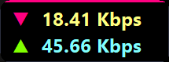
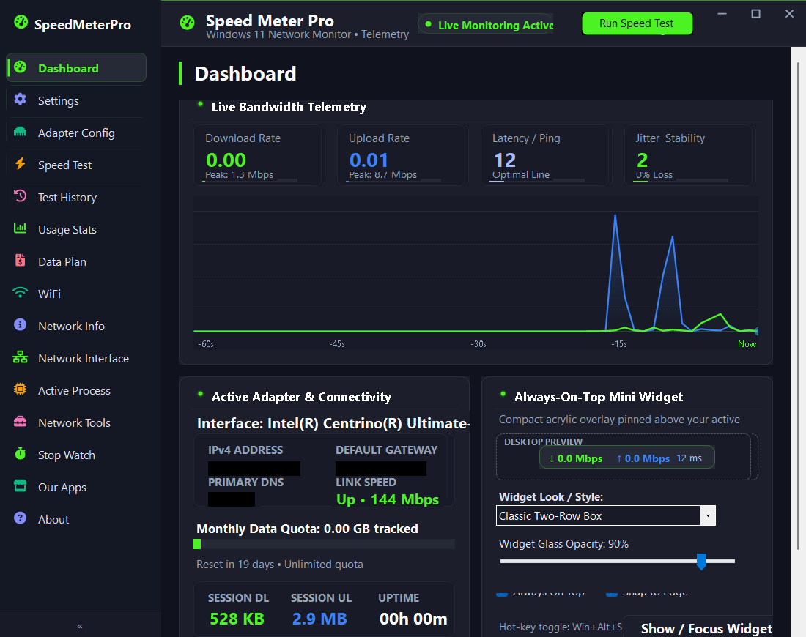
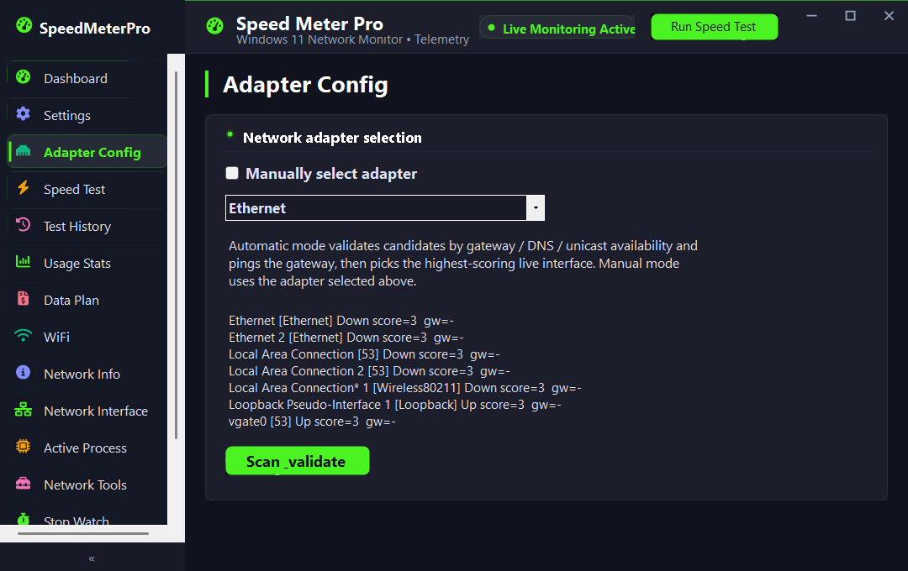
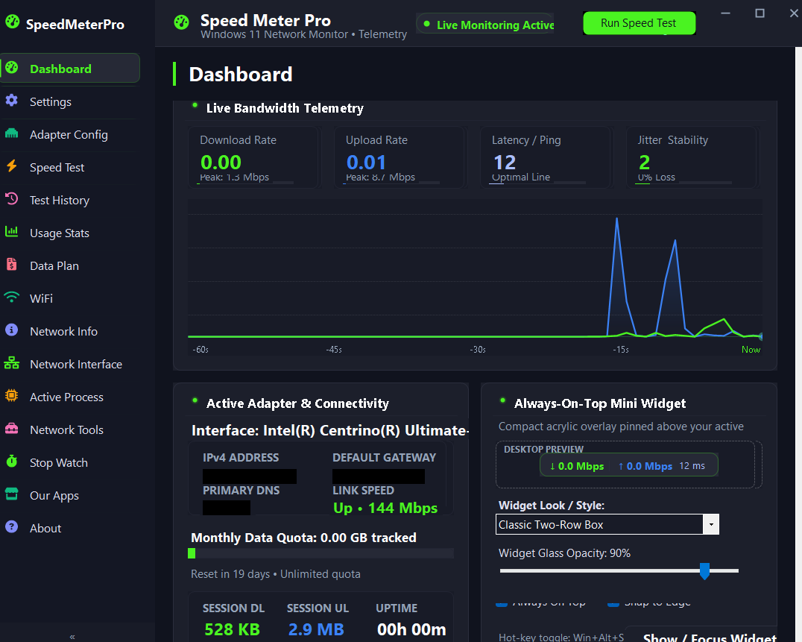

# SpeedMeterPro

<div align="center">


[](https://wa.me/923171616345?text=Hi%20letmese%2C%20I%20am%20interested%20in%20your%20SpeedMeterPro%20Windows%20application.)

### *Precision Real-Time Network Speed Monitor & Bandwidth Analytics for Windows*

</div>

---

## 📖 Overview

**SpeedMeterPro** is a modern, lightweight Windows desktop application engineered for power users, gamers, network engineers, and remote workers who require real-time visibility into their internet bandwidth and local network adapter behavior.

Unlike heavy web-based monitors or ad-cluttered tools, SpeedMeterPro runs unobtrusively in your system tray and desktop screen edge, delivering real-time download/upload telemetry with minimal CPU and RAM overhead.

---

## 📸 Desktop Application Preview

<div align="center">
  <p><b>Always-on-Top Floating Speed Widget & Taskbar HUD:</b></p>
  
</div>

<br/>

<div align="center">
  <p><b>Main Analytics Dashboard & Precision Network Telemetry:</b></p>
  
</div>

<br/>

<div align="center">
  
  
</div>

---

- ⚡ **Floating Desktop Widget:** Sleek, customizable always-on-top overlay showing current download/upload speed. Fully movable with adjustable opacity and dark/light theme presets.
- 📊 **Comprehensive Analytics Dashboard:** Full window interface detailing current session statistics, historical bandwidth consumption, and peak speeds.
- 🚀 **Integrated Speed Test Engine:** Built-in multi-threaded speed test runner to measure ping, jitter, download, and upload speeds against reliable endpoints.
- 🔍 **Active Process Network Inspector:** View which background applications or system processes are actively consuming your network bandwidth.
- 📶 **Wi-Fi Signal & Adapter Analyzer:** Inspect connected SSID, BSSID, channel, signal quality percentage, RSSI, and IP/DNS configurations.
- 🛑 **Data Plan Quota & Toast Alerts:** Set daily, weekly, or monthly data caps with native Windows toast warnings to prevent ISP overage charges.
- ⏱️ **Session Stopwatch Meter:** Track exact byte usage during a specific gaming session, video download, or conference call.
- 🔔 **Native System Tray Integration:** Minimize to notification area with quick-access context menus and hotkey toggles.

---

## 🛠️ Architecture & Tech Stack

- **Framework:** .NET (Windows Desktop / Windows Forms with custom modern styling)
- **Language:** C#
- **Telemetry Engine:** Windows Performance Counters & Network Interface API (`System.Net.NetworkInformation`)
- **Typography & Icons:** FontAwesome Solid vector icons bundled natively in assets
- **Storage:** Local encrypted configuration store for user preferences and history data

---

## 📂 Project Structure

```
SpeedMeterPro_Source/
├── Assets/                 # Fonts, application icons, and design resources
├── Entitlement/            # Feature entitlement and licensing modules
├── Models/                 # Data contracts, viewmodels, and server definitions
├── Pages/                  # Modular view panels (Dashboard, SpeedTest, Wifi, Usage, etc.)
├── Services/               # MeasurementEngine, SpeedTestRunner, ToastSystem, WifiHelper
├── UI/                     # DashboardForm and floating WidgetForm
├── Program.cs              # Application entry point and lifecycle manager
└── SpeedMeterPro.csproj    # Project definition and build configurations
```

---

## 🚀 Building from Source

### Prerequisites
* Windows 10 or 11 (64-bit)
* Visual Studio 2022 (with *.NET desktop development* workload) or .NET SDK

### Build Instructions
1. Clone the repository:
   ```bash
   git clone https://github.com/letmese/SpeedMeterPro.git
   cd SpeedMeterPro
   ```
2. Build the project:
   ```bash
   dotnet build SpeedMeterPro.csproj -c Release
   ```
3. Run the executable from `bin/Release/`.

---

## 📦 Pre-Built Downloads

For the standalone, ready-to-run `.exe` (no compiler required), visit the releases page or download from the backup archive:
* **[GitHub Releases](https://github.com/letmese/SpeedMeterPro/releases)**

---

## 👨‍💻 Developer & Inquiries

Developed and maintained by **letmese**.

* **GitHub:** [@letmese](https://github.com/letmese)
* **Location:** Lahore, Pakistan (Available for custom software development worldwide)
* **WhatsApp Direct:** [**+92 317 1616345**](https://wa.me/923171616345?text=Hi%20letmese%2C%20I%20am%20interested%20in%20your%20SpeedMeterPro%20Windows%20application.)

---

## 📄 License

This project is licensed under the [MIT License](LICENSE).
